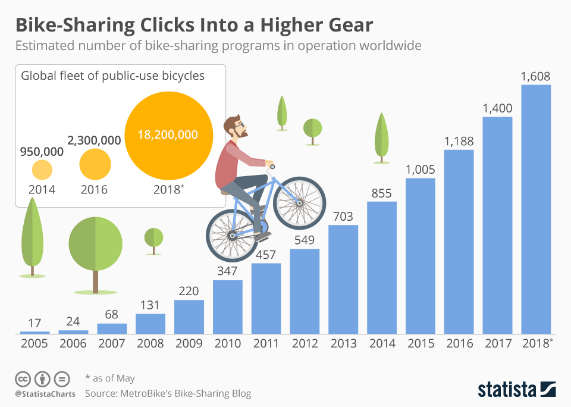

## **Predicting Bike Sharing Demand with Regression Models** 

By Aditya Nugraha


*Image Source: https://www.freepik.com/vectors/ride-bicycle*

### **Contents**

1. Business Problem Understanding
2. Data Understanding
3. EDA & Feature Engineering
4. Modeling
5. Conclusion
6. Recommendation
7. Save Model

### Environment Setup

Install the notebook dependencies in the same Python environment used by your notebook. In a notebook code cell, run:

```python
%pip install -r requirements.txt
```

Then restart the kernel and run the notebook from the first cell. In a terminal opened at the project folder, you can use `python -m pip install -r requirements.txt` instead. The PyPI package `category-encoders` is imported in Python as `category_encoders`.

**Context**

Sistem penyewaan sepeda adalah sarana penyewaan sepeda dimana proses mendapatkan keanggotaan, sewa, dan pengembalian sepeda secara mandiri melalui jaringan lokasi seperti kios di seluruh kota. Dengan menggunakan sistem ini, orang dapat menyewa sepeda dari satu lokasi dan mengembalikannya ke lokasi lain sesuai kebutuhan. Menurut data yang di rilis pada situs [Statista.com](https://www.statista.com/chart/14542/bike-sharing-programs-worldwide/) Hingga pertengahan tahun 2018, ada sekitar 1600 program penyewaan sepeda dengan 18,2 juta sepeda di lebih dari 1000 kota.



*Image Source: https://www.statista.com/chart/14542/bike-sharing-programs-worldwide/*

**Problem Statement**

Terlepas dari efek positifnya pada lalu lintas, masalah lingkungan dan kesehatan, sistem penyewaan sepeda sangat menarik karena data yang mereka hasilkan dapat digunakan untuk tujuan penelitian. Waktu keberangkatan dan kedatangan, lokasi dan durasi penggunaan dicatat dalam sistem ini. Data tersebut dapat digunakan untuk memprediksi kapan waktu, kondisi, dan tempat yang tepat bagi masyarakat untuk melakukan penyewaan sepeda, sekaligus menjadi masalah tersendiri bagi penyedia sistem penyewaan sepeda ini untuk **mengetahui seberapa banyak sepeda yang harus di distribusikan agar sepeda mereka dapat digunakan secara efisien sehingga mengurangi kemungkinan adanya kondisi yang mempunyai banyak sepeda namun sedikit yang menggunakannya ataupun sebaliknya.**

**Goals**

Berdasarkan permasalahan yang telah dijelaskan sebelumnya, pihak yang mengadakan program penyewaan sepeda perlu memiliki 'tool' yang dapat digunakan untuk **memprediksi seberapa banyak sepeda yang harus di distribusikan berdasarkan kondisi tertentu**. adanya perbedaan kondisi dan waktu dapat menambah keakuratan dalam memprediksi banyaknya sepeda yang digunakan, yang mana dapat mendistribusikan sepeda secara efisien sehingga penyedia dapat memaksimalkan keuntungan dari penyewaan tersebut.

**Analytics Approach**

Jadi, yang perlu dilakukan adalah menganalisis data untuk menemukan pola dari fitur-fitur yang ada, yang membedakan pada kondisi dan waktu tertentu.

Selanjutnya, kita akan membangun suatu model untuk memprediksi suatu nilai numerik atau biasa disebut dengan model regresi, model ini dapat digunakan sebagai 'tool' yang membantu penyedia sistem penyewaan sepeda ini untuk memprediksi banyaknya penyewa berdasarkan kondisi dan waktu tertentu.

**Metrics Evaluation**

This regression project reports four complementary metrics:

| Metric | What it measures | Updated chronological score |
| --- | --- | --- |
| RMSE | Typical prediction error in bike-count units, with larger errors penalized more heavily. | Pending rerun |
| RMSLE | Error on a logarithmic scale, emphasizing relative differences. | Pending rerun |
| MAE | Average absolute prediction error in bike-count units. | Pending rerun |
| MAPE | Average percentage error; interpret cautiously when actual demand is zero or near zero. | Pending rerun |

**Validation protocol (updated):** Rows are ordered by `dteday` and `hr`. The first 80% are used for training and model selection; the latest 20% are held out for final evaluation. Five-fold `TimeSeriesSplit` is used within the training period for benchmarking and hyperparameter tuning. The `casual` and `registered` columns are dropped before building `X` because they are components of the target `cnt` and are not available when forecasting future demand.

**Score status:** The previous scores were calculated with shuffled splits and are withdrawn as forward-looking estimates. The metrics above must be filled in after the notebook is rerun with the chronological protocol.

---

### **Data Understanding**

Sistem penyewaan sepeda sangat berkorelasi dengan kondisi lingkungan dan musim. Misalnya, kondisi cuaca,
curah hujan, hari dalam seminggu, musim, jam dalam sehari, dll. hal tersebut dapat mempengaruhi perilaku penyewa apakah seseorang dengan kondisi tersebut ingin menyewa sepeda atau tidak.

* Dataset menunjukkan data sewa sepeda per jam selama dua tahun (2011 dan 2012). 
* Memiliki 11 atribut yang masing-masing menunjukan waktu penyewaan, kondisi lingkungan, dan banyaknya sepeda yang disewa

|Atribute|Data Type|Description|
|---|---|---|
|dteday|Datetime|Date|
|hum|Float|Normalized Humadity. The values are divided to 100 (maximum value)|
|weathersit|Integer|1: Clear, few clouds, partly cloudy<br>2: Mist, cloudy, mist and broken clouds, mist and few clouds<br>3: Light snow, light rain and thunderstorm and scattered clouds, light rain and scattered clouds<br>4: Heavy rain, ice pallets, thunderstorm and mist, snow and fog|
|holiday|Integer|Whether the day is holiday or not (1: holiday, 0: not holiday). References: [2011](https://dchr.dc.gov/page/holiday-schedules-2010-and-2011), [2012](https://dchr.dc.gov/page/holiday-schedules-2012-and-2013)|
|season|Integer|Season (1: Winter, 2: Spring, 3: Summer, 4: Fall)|
|atemp|Float|Normalized feeling temperature in Celsius. The values are divided to 50 (maximum value)|
|temp|Float|Normalized temperature in Celsius. The values are divided to 41 (maximum value)|
|hr|Integer|Hour (0 to 23)|
|casual|Integer|Count of casual users|
|registered|Integer|Count of registered users|
|cnt|Integer|Count of hourly total rental bikes including both casual and registered (Target variable)|

### **EDA & Feature Engineering**

- Beradasarkan penelitian yang dilakukan, dataset yang digunakan tidak memiliki NaN maupun data terduplikat.
- Kami juga menghapus kolom `casual` dan `registered` karena 2 kolom tersebut telah terwakilkan oleh kolom target yaitu `cnt`
- Nilai permintaan tinggi dipertahankan karena dapat mencerminkan permintaan nyata. Kami tidak menghapus baris menggunakan batas 3-sigma dari seluruh rangkaian waktu; cara itu dapat membuang puncak permintaan dan menggunakan informasi dari periode uji.
- Model menerapkan `log1p` pada target `cnt` selama fitting dan mengubah prediksi kembali ke jumlah sepeda. Metrik dihitung pada skala jumlah sepeda.
- Untuk EDA standar lainnya kami juga mengecek menggunakan plot kategori dan plot distribusi pada masing-masing tabel yang berjenis kategori dan berjenis numerik.

### **Modeling**

**Date Extraction**

Untuk memperkaya data dan mempermudah dalam melakukan interpretasi maka fitur `dteday` akan kita ekstrak menjadi bagiannya sendiri, fitur baru hasil ekstraksi beserta keterangannya bisa dilihat tabel dibawah.

|Atribute|Data Type|Description|
|---|---|---|
|year|Integer|Year (2011 to 2012)|
|month|Integer|Month (1 to 12)|
|day|Integer|Day (1 to 31)|
|weekday|Integer|Day of the week (0: Monday, 1: Tuesday, 2: Wednesday, 3: Thursday, 4: Friday, 5: Saturday, 6: Sunday)|
|workingday|Integer|If the day is neither weekend (saturday & sunday on weekday column) nor holiday is 1, otherwise is 0|

**Chronological Data Split**

Rows are sorted by `dteday` and `hr`. The earliest 80% are used for training and time-ordered cross-validation; the latest 20% are reserved for final evaluation. The target remains in bike-count units, and each estimator applies `log1p` during fitting and returns predictions to the count scale.

**Encoding** 

kita perlu melakukan encoding pada fitur kategorik karena komputer tidak dapat memproses data berbentuk kategorik, walaupun nilainya sudah berupa angka namun itu adalah nilai kategorik, jika di proses dengan data seperti itu maka akan membuat model salah dalam melakukan prediksi.

**One-Hot:** season, year, weekday, weathersit, holiday  
**Binary:** month, day, hr

**Simple Model Benchmarking**

The notebook benchmarks `LinearRegression`, `DecisionTree`, `RandomForest`, `XGBoost`, and `LightGBM` using five-fold `TimeSeriesSplit` on the training period. The ranking must be determined from the fresh CV results after rerunning the notebook; old shuffled-split rankings are withdrawn. All metrics are evaluated on bike-count predictions, with `log1p` applied inside each estimator during fitting.

**Simple Modeling and Predicting with RandomForest, XGBoost, LightGBM**

The notebook fits an untuned XGBoost baseline and evaluates it on the final chronological holdout. Choose the model to tune from training-period cross-validation only; do not use the held-out final period for model selection. The previous claim that XGBoost had the lowest error is withdrawn until the corrected CV is rerun.

**Hyperparameter Tuning**

The notebook tunes `XGBoost` using `RandomizedSearchCV` and five-fold `TimeSeriesSplit`, using only the earliest 80% training period. The selected estimator minimizes mean squared logarithmic error (MSLE) in bike-count units. `RandomizedSearchCV` samples the parameter space rather than checking every combination, as `GridSearchCV` does.

Untuk hyperparameter spacenya sendiri yang kami gunakan adalah `max_depth` yaitu kedalaman maksimal dari pohon, `learning_rate` yaitu penyusutan ukuran langkah digunakan dalam pembaruan untuk mencegah overfitting, `n_estimator` yaitu jumlah maksimal pohon, `subsample` yaitu rasio subsampel dari instance pelatihan, `gamma` yaitu pengurangan kerugian minimum yang diperlukan untuk membuat partisi lebih lanjut pada simpul daun pohon, `colsample_bytree` yaitu rasio subsampel kolom saat membangun setiap pohon, dan `reg_alpha` yaitu untuk melakukan regularisasi L1 pada bobot. Outside the parameter space, `n_iter` is 50, `cv` uses `TimeSeriesSplit(n_splits=5)`, the scoring metrics are negative RMSE, MSLE, MAE, and MAPE, and refitting selects the estimator with the lowest MSLE.

**Tunned Modeling and Predicting with XGBoost**

Tahap ini melakukan proses fitting ulang menggunaakn parameter terbaik yang didapat dari tahap tuning sebelumnya, lalu melakukan prediksi pada test set.

**Performance Comparison**

Perbandingan model `XGBoost` sebelum dan sesudah tuning harus dihitung ulang menggunakan pembagian data kronologis. Skor dari pembagian acak sebelumnya tidak dilaporkan sebagai perkiraan performa untuk memprediksi periode mendatang. Nilai RMSE, RMSLE, MAE, dan MAPE yang baru akan dicatat setelah notebook dijalankan kembali.

**Feature Importances**

Pada tahap ini kami mencari fitur apa saja yang paling memengaruhi kolom target yaitu `cnt`, kami mengeceknya menggunakan fungsi `feature_importances_`.

**Predicted Vs Actual Value**

Kami juga mengecek secara langsung sekaligus membandingkan nilai aktual dengan hasil prediksi menggunakan model sebelum dituning dan setelah dituning 

### **Conclusion**

Model performance, residual behavior, and feature importance must be reviewed after the notebook is rerun with the corrected chronological protocol. Previous shuffled-split scores and conclusions are withdrawn. Report RMSE, RMSLE, MAE, and MAPE from the held-out final period; interpret MAPE cautiously when actual demand is zero or near zero.

### **Recommendation**

Untuk mengembangkan model agar dapat menjadi lebih baik lagi dapat dilakukan hal-hal berikut ini:
1. Mengecek performa pada model lain yang tidak kita gunakan saat ini seperti Ridge, Lasso, ataupun yang lebih kompleks seperti Neural Network, dll. hal ini dapat meningkatkan kemungkinan adanya model yang berpotensi menjadi lebih baik lagi. terutama dengan membandingkan seluruh kandidat menggunakan prosedur validasi kronologis yang sama dan melaporkan metrik yang sesuai dengan kebutuhan operasional.

1. Lakukan penambahan fitur yang mungkin akan mempunyai korelasi tinggi terhadap target, misalkan seperti lokasi, kecepatan angin, perkiraan cuaca beberapa waktu kedepan, lama sepeda digunakan, dll. jika memungkinkan, lakukan penambahan data secara signifikan dengan mungkin memasukan data dari wilayan lain yang tidak tercakup pada data yang kita gunakan, hal ini perlu dilakukan untuk menambah keakuratan model yang dihasilkan.

1. Optimalkan parameter yang digunakan pada hyperparameter tuning, seperti yang telah diteliti sebelumnya bahwa hyperparameter tuning yang kita lakukan malah membuat performa model menurun, hal ini terjadi karena adanya limitasi pada pengetahuan yang dimiliki sehingga parameter yang digunakan hanya berdasarkan 'trial and error', diharapkan kedepannya dapat meningkatkan pengetahuannya pada hal tersebut.

1. Dataset yang digunakan memungkinkan kita untuk melakukan 'anomaly detection', yaitu melakukan pendeteksian jika terjadi hal diluar kebiasaan, misal seperti jam 1 malam yang seharusnya hanya sedikit atau mungkin tidak ada sama sekali yang menyewa sepeda namun yang terjadi saat itu adalah sebaliknya, sepeda yang disewa pada saat itu malah sangat tinggi yang mungkin disebabkan oleh faktor eksternal seperti misalnya adanya konser ataupun acara besar lainnya didekat lokasi penyewaan sepeda pada waktu tersebut, hal ini membuat sistem mendeteksi adanya kebiasaan yang tidak wajar, fungsinya sendiri karena penyewaan sepeda ini dilakukan secara online dan terintegrasi maka penyedia penyewaan sepeda dapat secara cepat melakukan distribusi pada area tersebut jika memungkinkan.

### **Save, Load, Predict Model with Pickle**

The notebook saves the tuned XGBoost pipeline after it has been rerun with the corrected chronological protocol. The existing `.sav` file should be regenerated before presenting it as the updated model. The notebook also includes example code for scoring new labeled data.
